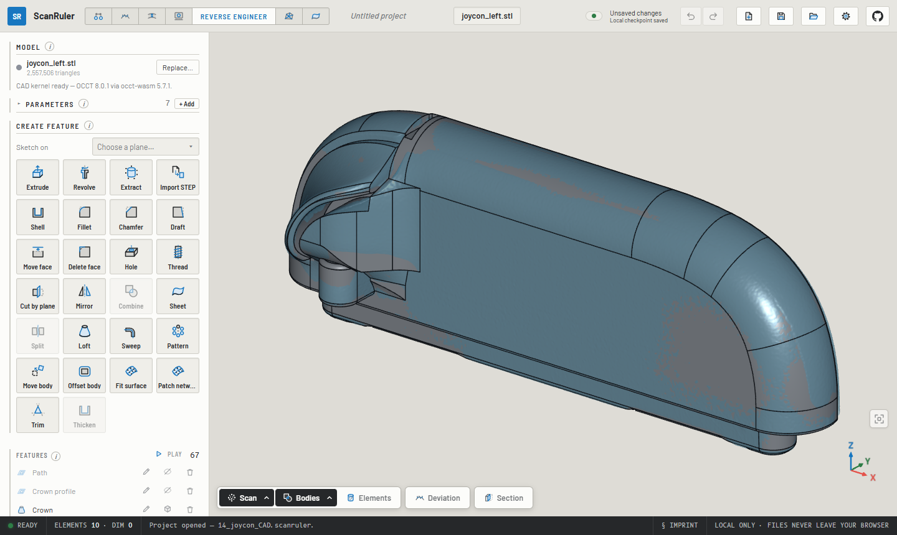
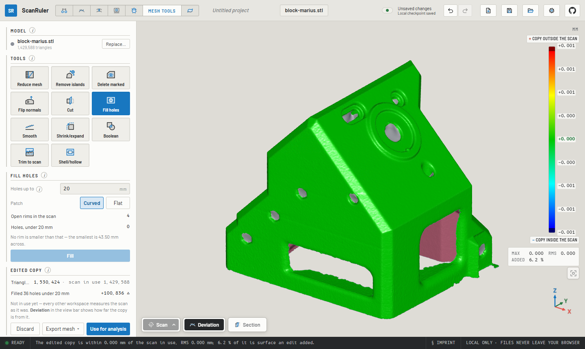

<picture>
  <source media="(prefers-color-scheme: dark)" srcset="docs/brand/scanruler-logo-horizontal-on-dark.svg" />
  
</picture>

# ScanRuler by CNC Kitchen

**Use it live at <https://scanruler.com/>** — nothing to install.

> **Open source under the AGPL, with commercial licenses available.** Want to
> build ScanRuler into closed-source software, or host a modified version
> without publishing its source? Write to <stefan@cnckitchen.com>, see
> [COMMERCIAL.md](COMMERCIAL.md).

Check a 3D scan against what it should have been, entirely in your browser:
fit spheres, cylinders and planes to the scan and measure between them, paint
its deviation from the CAD part, map its wall thickness, or measure a flatbed
scan the way a measuring microscope would. On scanruler.com you can also
model the scan into a solid STEP body and clean up or reduce the mesh.

**Everything runs locally.** Your files are processed in your browser and
never leave your computer.


- [What it does](#what-it-does)
- [Getting started](#getting-started)
- [Files in and out](#files-in-and-out)
- [Good to know](#good-to-know)
- [Agents](#agents)
- [Automatic reverse engineering](#automatic-reverse-engineering)
- [Development](#development)
- [License](#license)

The full reference, with every option and how each measurement is computed,
is the [manual](docs/manual.md).

## What it does

All workspaces work on the same loaded scan. The first four are in this
repository. [Reverse engineer and Mesh Tools](#reverse-engineer-and-mesh-tools-on-scanrulercom)
are only on scanruler.com.

### 3D Measure

Click a feature on the scan and get a fitted **sphere, cylinder, cone,
torus, plane or circle**: a Gaussian best fit with its σ and form error,
with the surface around your click picked automatically. You can also mark
the surface by hand with a brush, a window or a lasso. Build **points, lines
and planes** from the fits, then add the **distance and angle dimensions** you
need between them, the way GOM Inspect or PC-DMIS does it. Each dimension
can be held to a nominal ± tolerance, and **GD&T** checks flatness,
parallelism, perpendicularity, coaxiality and the rest.

- **Align the part** with a guided 3-2-1 datum alignment, an **Auto-align**
  read off the scan's own faces, or its **symmetry plane**.
- **Cut a section** across any element and measure the cut on the 2D
  sheet. A **shadow** section gives the part's widest outline instead, as
  lines and arcs with clearance all round, for drawing a bin, a foam cutout
  or a pocket.
- **Export STEP** of what you measured as analytic geometry (faces, solid
  cylinders and balls, the section curves, the shadow as a solid), ready to
  build on in CAD.


### Deviation

Load the nominal part as a mesh or as a **STEP file** straight from CAD,
press **Align automatically**, and the scan is best-fitted onto it and
painted with the signed deviation. Hover for a reading, click to pin one.
If the scan carries a fixture, spray or supports that pull the fit off,
**align by picking points** or run a **local fine fit** on the surface you
mark. **Find volume errors** lists whole regions of extra or missing
material, such as a boss that was never modelled or a pocket that was never
cut. **Animate the deformation** plays the map as exaggerated motion, like
an FE deformed-shape plot. Instead of a reference model, the map can also be
measured against **one fitted element**: is this face flat, is this bore
round?


### Wall thickness

Load one file and press **Measure wall thickness**. There is no reference and
no alignment: a ray (or a sphere) is cast across the material from every
point, and the thin walls light up red.


### 2D Measure

Drop in a **flatbed scan** of a flat part (PNG or JPEG) or pick a
**section** cut through the 3D scan. Edges are detected to subpixel
accuracy. Fit **points, lines, circles, arcs and splines** to them with a
click, a box or picked points, dimension between them, and export the sheet
at true scale as **SVG, DXF or CSV**. A flatbed image stays flagged
**UNCALIBRATED** until you calibrate it against something of known size on
the glass. Its scale can be saved as a scanner profile.


### Reverse engineer and Mesh Tools, on scanruler.com

These two workspaces are free to use at <https://scanruler.com/>. They are
closed source: not part of this repository and not covered by its license.
They also run entirely in your browser.

**Reverse engineer** turns the scan into a **solid body** in a STEP file that
CAD opens as a part, not just datums. Sketch on a section through the scan:
**Fit all chains** reads the slice as lines and arcs, and constraints and
dimensions hold it. Then **extrude** or **revolve** it, and add **fillets,
chamfers, shells, holes, threads, drafts, mirrors, patterns, lofts and
sweeps**. Freeform parts are modelled from **surfaces fitted to the scan**,
or a network of B-spline patches drawn over it. **Compare in Deviation**
checks the bodies against the scan. No scan is needed to model: on a blank
stage it works like a small parametric CAD tool.



**Mesh Tools** works on the mesh itself:
- **Clean it up**: remove islands, delete marked surface, flip normals, cut
  at a plane, fill holes, smooth, shrink or expand, booleans with measured
  cylinders or modelled bodies, shell or hollow.
- **Edited copy**: every edit lands on a copy of the scan, which you can
  measure against the original before every workspace takes it into use.
- **Reduce mesh** makes a light mesh for CAD, held within a tolerance of the
  scan.
- A modelled replacement piece can be cut to fit the break of a broken part.



## Getting started

1. **Open a scan**: drag it anywhere into the window, or press **Load**.
   An STL has no units, so you are asked what it is in.
2. In **3D Measure**, press **Sphere**, **Cylinder** or **Plane** and click
   that feature on the scan. The fit previews in grey; press **Create** (or
   `Enter`, or the middle mouse button). If the feature is broken into
   patches, click each one.
3. Press **New dimension**, choose the type and pick the two elements.
   **Copy summary** puts every result on the clipboard.
4. Everything stays editable: the **✎** key on any row reopens it, and
   **Undo / Redo** (`Ctrl+Z`, `Ctrl+Shift+Z`) work across all workspaces.
5. **Save** writes the whole session to one `.scanruler` project file.

New here? An amber ring points to the control to press next and retires once
you have used a workspace twice. You can switch it off under **⚙ Settings**.
**⚙ Settings → Units** shows and takes lengths in millimetres or inches;
files, projects and agent answers stay in millimetres.

## Files in and out

| | Formats |
| --- | --- |
| **Scan** | STL, PLY, OBJ (with its `.mtl` and texture, in colour), 3MF, STEP |
| **Reference part** | STL, PLY, OBJ, 3MF, STEP (tessellated in the browser by [meshStep](https://github.com/CNCKitchen/meshStep)) |
| **Flatbed image** | PNG, JPEG (the file's dpi is read as a working scale) |
| **Project** | `.scanruler`: a plain zip of the input files and `project.json` |
| **Elements** | STEP (AP214) as analytic geometry: solids and faces, or construction surfaces |
| **Scan** | STL or 3MF mesh; PLY or XYZ point cloud with normals, in the pose it is aligned to |
| **2D sheet** | SVG and DXF at 1:1, CSV of elements and dimensions |
| **Reports** | Plain text to the clipboard (*Copy summary*, *Copy report*) |

## Good to know

- **Navigation**: left-drag rotates about the point under the cursor,
  right-drag pans, the wheel zooms. Number keys give the standard views
  (`0` iso, `1` top, `3` front …). The button above the axis gizmo fits the
  part back into view. **⚙ Settings → Mouse controls** switches to the mouse
  scheme of your CAD tool. A 3Dconnexion **SpaceMouse** works in Chrome and
  Edge, and touch screens work too.
- **View bar** (bottom left): show or hide the scan, reference and elements,
  make them transparent, show the mesh or the back faces. **Section** cuts
  everything open at a plane to look inside.
- **Recovery**: work is checkpointed in your browser every few seconds, and
  a later visit offers to restore it. Use **Save** for a portable copy.
- **Open from a link**: `https://scanruler.com/?open=<url-of-a-file>` opens
  any file the hosting server allows the app to read (CORS), and
  `&workspace=deviation` picks where to land.
- **Accuracy**: on a real structured-light scan of a ball bar, the centre
  distance agrees with GOM Inspect to its last digit (148.639 mm against
  148.64 mm). A scan displaced at random comes back to within 0.9 µm of
  its fitted pose.

## Agents

An AI agent on your computer can drive the ScanRuler tab you have open:
Claude Code, Codex, Claude Desktop, Cursor or anything else that speaks the
[Model Context Protocol](https://modelcontextprotocol.io). For example: *"Open
ballbar.stl, fit both spheres, measure the centre distance and give me the
report."* It works the panels step by step in front of you, and every step
can be undone. On scanruler.com it can also
[model a scan into a solid](#automatic-reverse-engineering) in Reverse
engineer and clean up a scan in Mesh Tools.

You need [Node.js](https://nodejs.org/) 22 or newer and Chrome, Edge or
Firefox. Add the helper to your agent once:

```bash
claude mcp add --scope user scanruler -- npx -y scanruler-mcp@latest   # Claude Code
codex mcp add scanruler -- npx -y scanruler-mcp@latest                 # Codex
```

For Claude Desktop, Cursor and others, add `"command": "npx", "args": ["-y",
"scanruler-mcp@latest"]` to their MCP settings. Then say *"Connect to
ScanRuler"*. It opens the app paired with the agent, and the first time the
browser asks whether the site may reach *apps and services on this device*;
click **Allow**. After that, ask for what you want measured, naming files by
their full path.

The helper runs on your own machine and the tab talks to it on `127.0.0.1`.
Nothing leaves your computer through ScanRuler, though what the agent reads
goes to its model provider as usual. Setup per agent, troubleshooting and
every option are in [mcp/README.md](mcp/README.md).

## Automatic reverse engineering

An AI agent can drive Reverse engineer from start to finish: give it a scan
and it hands back a solid STEP body, an editable project and a report of how
well the two agree. Connect an agent [as above](#agents) on scanruler.com and
ask, for example: *"Reverse engineer C:\parts\bracket.stl into a solid STEP.
Ask me what you need to know before you start."*

Expect a long working session rather than a button. ScanRuler measures and
builds; your agent, on your own model subscription, makes the decisions.

### How it works

The app serves the agent a guide for the job, so the instructions always match
the build in the tab. Following it, the agent:

1. **Checks the scan**: open rims, noise, faces that should be parallel but
   are not. Then it looks at the part from every side and lists its regions
   and features.
2. **Classifies the part.** How it was made sets the tolerance, from about
   ±0.02 mm for a machined face to ±0.5 mm for a sand casting, and never finer
   than three times the scan's noise. The part type sets how to build it. The
   guide knows plates, turned, machined and sheet-metal parts, shelled and
   faceted housings, moulded housings with keys, castings with machined
   features, smooth solid castings, rotationally patterned parts such as fans,
   volutes, and freeform shells and surfaces.
3. **Asks you once**, in the chat, before the first feature: its defaults
   (one continuous body, lettering left off and so on) and its approach. It
   also sets a target: by default 90 % of the scan within tolerance on
   analytic parts, 85 % on castings and mouldings, 75 % on freeform shapes.
4. **Builds the way a designer would**: aligned to the faces the part mates
   on, sketches fitted to sections through the scan, relations the design
   means held as constraints, and round numbers where the measurement allows.
5. **Loops on the deviation.** After each group of features it reads the
   deviation map and the volume error, works on the worst place and measures
   again.
6. **Hands over** a STEP file, a `.scanruler` project with every feature
   editable, deviation pictures and a report marking each feature as measured,
   partly supported or inferred. The run ends when the target is met and every
   listed region is built or named as skipped, or when you accept less.
   Otherwise the agent is told to say "not done".

### Where it reaches its limits

Four real runs, on different builds of the app, so examples and not a
benchmark. The fan, the rumble pak and the scooter cover also took notes from
a person along the way.

| Part | Part type | Scan within tolerance | RMS |
| --- | --- | --- | --- |
| Die-cast fan wheel | Rotationally patterned | 96.3 % within ±0.3 mm | 0.117 mm |
| Moulded rumble pak | Moulded housing | 86.1 % within ±0.2 mm | 0.173 mm |
| Die-cast mirror holder | Smooth solid casting | 72.5 % within ±0.2 mm, reported as "not done" | 0.387 mm |
| Scooter head cover | Freeform thin shell | 68.9 % within ±0.4 mm (outer skin about 81 %) | 0.85 mm |

- **The numbers compare the model with the scan, not with the real part.** A
  high share says the surfaces are close. It does not say a bore has the right
  nominal or that the part will fit. Check the dimensions that matter yourself.
- **Freeform is the weakest case.** Grips, blades, fairings and organic shapes
  come out as a skin of patches fitted to the scan, not as a designer's
  parametric model.
- **It cannot model what the scan does not show**: deep pockets, whether a hole
  goes through, the inside of an assembly wrapped into one skin. It infers
  those, and the report says where.
- **A poor scan limits everything.** Nothing is trustworthy finer than about
  three times the scan's noise, and a warped or tilted scan can read as the
  shape of the part.
- **Design intent is a judgement.** Round numbers, symmetry and relations are
  the agent's choices, and they can be wrong.
- **Some features will not build.** Rounds are a common failure, and getting
  one to build can mean rebuilding what lies under it.
- **Agents cut corners.** Results differ from run to run and from model to
  model. An agent can skip a step of the guide or sum up too kindly, so read
  the report's numbers and look at the maps.
- **It costs time and tokens.** The fan wheel took 106 minutes and 284 tool
  calls. A run like that can use up a good part of your agent's usage limit.

### When your part does not come out right

Work down this list, cheapest first:

1. **Look at the scan.** Ask the agent what its scan check found. Rescan if the
   scan is warped or tilted. Mesh Tools can remove islands and fill holes.
2. **Tell it what the scan cannot**: what the part is, how it was made, what it
   mates with and which dimensions matter. Correct the part type if it chose
   the wrong one: *"This is a sand-cast pump housing at ±0.5 mm, build it as a
   volute. The bearing seat is machined."*
3. **Say how such parts are designed**: what the form grows from, and which
   features share lines and planes. A pump housing modelled from the scan's
   shapes was withdrawn twice; the third, based on how such pumps are designed,
   stood.
4. **Point at the problem on the part.** With the agent connection on
   (**⚙ Settings → Agents**), the Reverse engineer panel has **Notes for the
   agent**: press **Note**, click the place and say what is wrong. Fixing place
   by place usually beats starting over.
5. **Take over by hand.** Everything the agent built is an ordinary feature you
   can edit, suppress or undo.
6. **Keep what worked.** You cannot edit the guide the app serves, but your own
   first message or agent instructions (`CLAUDE.md`, `AGENTS.md`) go on top of
   it on every run: your part types, your tolerances, your order of work.

### Help improve the guide

Most of the guide was written from runs that went wrong, so a part that fails
is useful to us. The Reverse engineer guides are closed source like the
workspace, so there is nothing here to send a pull request against. Open a
[feature request](https://github.com/CNCKitchen/scanruler/issues/new?template=feature_request.yml)
instead, and we write what it teaches into the guide, as a refinement or a new
part type, in our own words. It helps to include:

- what the part is, how it was made and how you would have modelled it
- the report and deviation pictures, and where the run went wrong
- the scan or the `.scanruler` project, if you are allowed to share it. Issues
  are public, so a similar part you can share works too.
- a trace of the run, written when the helper is started with
  `--trace <dir> --trace-args`. It holds your file paths, so read it first.

Pull requests are welcome for what is in this repository: the measuring guides
in [src/commands/guides/](src/commands/guides/), and the fits, sections and
deviation underneath. They need the CLA, see [CONTRIBUTING.md](CONTRIBUTING.md).

## Development

```bash
npm install
npm run dev       # local dev server
npm test          # unit tests, plus acceptance tests on the local scans if present
npm run build     # type-check + production build to dist/
npm run e2e:ci    # browser tests on generated fixtures; run after building
```

The app is a static Vite + React + three.js build, with heavy geometry in a
Web Worker. Tests, the browser checks, releases and deployment are described
in [docs/development.md](docs/development.md).
`node scripts/readme-shots.mjs` retakes the pictures above.

## Roadmap

- Minimum-zone, minimum-circumscribed and maximum-inscribed fits
- Slots as elements, in 3D and on the 2D sheet; rectangles in 2D
- GD&T position and runout
- Point clouds (PLY with no faces) as scans
- The coloured deviation map exported, and carried onto sections

## License

**AGPL-3.0-only**, see [LICENSE](LICENSE). Free to use, modify, self-host
and redistribute. If you distribute it or offer it over a network (and a
browser app on a web server counts), your version's complete source must be
available under the same terms.

Want it inside closed-source software, or hosted without publishing your
changes? **Commercial exceptions are available**, see
[COMMERCIAL.md](COMMERCIAL.md). Contributions require the CLA in
[CONTRIBUTING.md](CONTRIBUTING.md), which also sets the dependency license
policy: no third-party copyleft in the app, enforced in CI by
[license-check.yml](.github/workflows/license-check.yml). The STEP importer
[meshStep](https://github.com/CNCKitchen/meshStep) is AGPL and is allowed
only because it is ours too, so a commercial exception for this app covers
it as well.

The bundled fonts are under SIL OFL 1.1 (license files in
[public/fonts/](public/fonts/)). The colour maps other than jet are the tables
of [viridisLite](https://github.com/sjmgarnier/viridisLite), MIT, © 2015 Simon
Garnier; the notice is in
[src/core/field/colormapData.ts](src/core/field/colormapData.ts). The project
name and the CNC Kitchen name and logo are trademarks and not covered by the
code license.

By [CNC Kitchen](https://www.cnckitchen.com).
