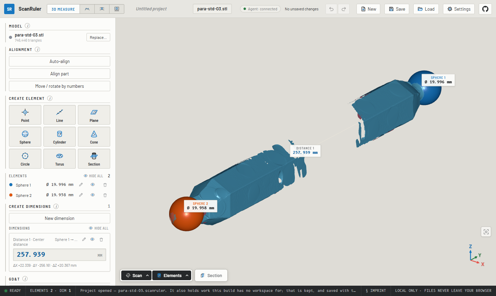
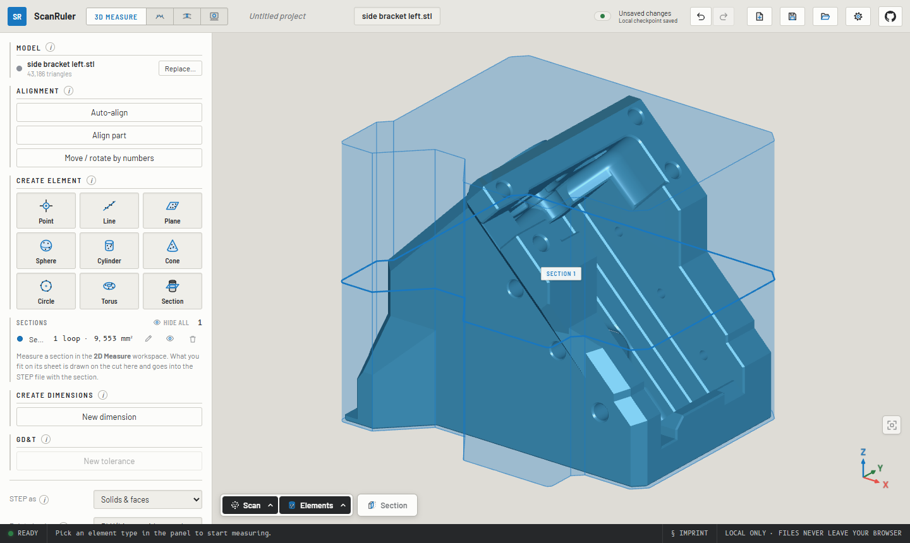
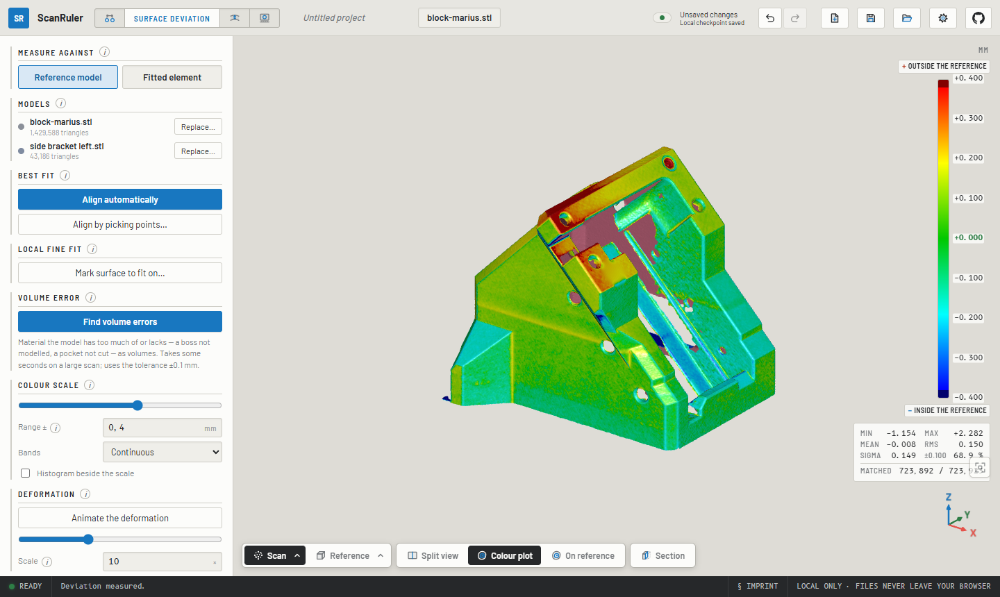
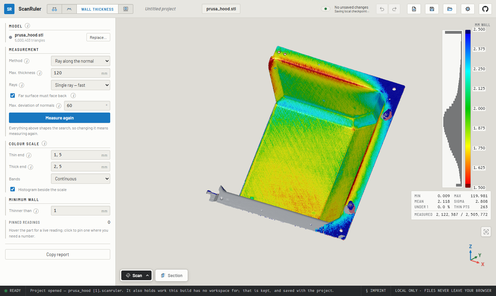
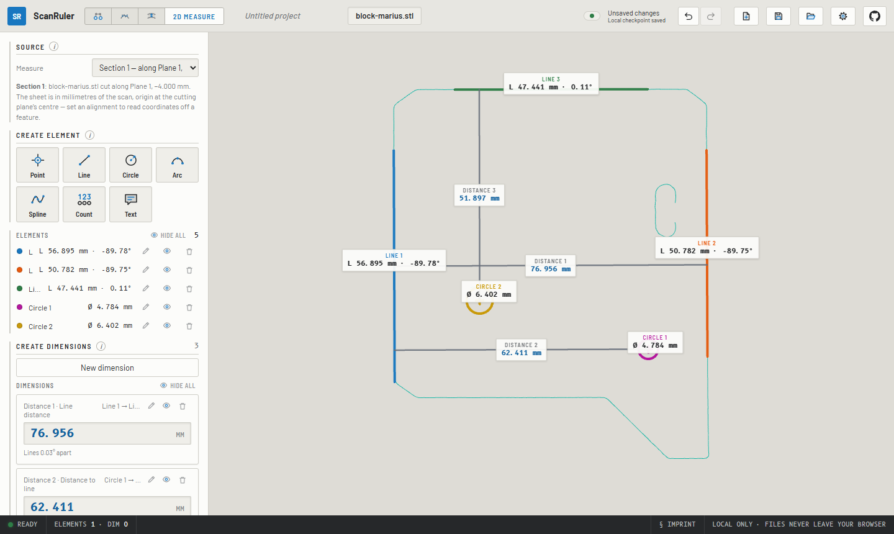

# ScanRuler by CNC Kitchen

**Use it live at <https://scanruler.com/>** — nothing to install.

Check a 3D scan against what it should have been, entirely in your browser:
fit spheres, cylinders and planes to the scan and measure between them, paint
its deviation from the CAD part, map its wall thickness, or measure a flatbed
scan the way a measuring microscope would.

**Everything runs locally.** Your files are processed in your browser and
never leave your computer.



- [What it does](#what-it-does)
- [Getting started](#getting-started)
- [Files in and out](#files-in-and-out)
- [Good to know](#good-to-know)
- [Agents](#agents)
- [Development](#development)
- [License](#license)

The full reference, with every option and how each measurement is computed,
is the [manual](docs/manual.md).

## What it does

ScanRuler has four workspaces, all working on the same loaded scan.

### 3D Measure

Click a feature on the scan and get a fitted **sphere, cylinder, cone,
torus, plane or circle**: a Gaussian best fit with its σ and form error,
with the surface around your click picked automatically. You can also mark
the surface by hand with a brush, a window or a lasso. Build **points, lines
and planes** from the fits, then add the **distance and angle dimensions** you
need between them, the way GOM Inspect or PC-DMIS does it. Each dimension
can be held to a nominal ± tolerance, and **GD&T** checks flatness,
parallelism, perpendicularity, coaxiality and the rest.

- **Align the part** with a guided 3-2-1 datum alignment, an **Auto-align**
  read off the scan's own faces, or its **symmetry plane**.
- **Cut a section** across any element and measure the cut on the 2D
  sheet. A **shadow** section gives the part's widest outline instead, as
  lines and arcs with clearance all round, for drawing a bin, a foam cutout
  or a pocket.
- **Export STEP** of what you measured as analytic geometry (faces, solid
  cylinders and balls, the section curves, the shadow as a solid), ready to
  build on in CAD.



### Deviation

Load the nominal part as a mesh or as a **STEP file** straight from CAD,
press **Align automatically**, and the scan is best-fitted onto it and
painted with the signed deviation. Hover for a reading, click to pin one.
If the scan carries a fixture, spray or supports that pull the fit off,
**align by picking points** or run a **local fine fit** on the surface you
mark. **Find volume errors** lists whole regions of extra or missing
material, such as a boss that was never modelled or a pocket that was never
cut. **Animate the deformation** plays the map as exaggerated motion, like
an FE deformed-shape plot. Instead of a reference model, the map can also be
measured against **one fitted element**: is this face flat, is this bore
round?



### Wall thickness

Load one file and press **Measure wall thickness**. There is no reference and
no alignment: a ray (or a sphere) is cast across the material from every
point, and the thin walls light up red.



### 2D Measure

Drop in a **flatbed scan** of a flat part (PNG or JPEG) or pick a
**section** cut through the 3D scan. Edges are detected to subpixel
accuracy. Fit **points, lines, circles, arcs and splines** to them with a
click, a box or picked points, dimension between them, and export the sheet
at true scale as **SVG, DXF or CSV**. A flatbed image stays flagged
**UNCALIBRATED** until you calibrate it against something of known size on
the glass. Its scale can be saved as a scanner profile.



## Getting started

1. **Open a scan**: drag it anywhere into the window, or press **Load**.
   An STL has no units, so you are asked what it is in.
2. In **3D Measure**, press **Sphere**, **Cylinder** or **Plane** and click
   that feature on the scan. The fit previews in grey; press **Create** (or
   `Enter`, or the middle mouse button). If the feature is broken into
   patches, click each one.
3. Press **New dimension**, choose the type and pick the two elements.
   **Copy summary** puts every result on the clipboard.
4. Everything stays editable: the **✎** key on any row reopens it, and
   **Undo / Redo** (`Ctrl+Z`, `Ctrl+Shift+Z`) work across all workspaces.
5. **Save** writes the whole session to one `.scanruler` project file.

New here? An amber ring points to the control to press next and retires once
you have used a workspace twice. You can switch it off under **⚙ Settings**.

## Files in and out

| | Formats |
| --- | --- |
| **Scan** | STL, PLY, OBJ (with its `.mtl` and texture, in colour), 3MF, STEP |
| **Reference part** | STL, PLY, OBJ, 3MF, STEP (tessellated in the browser by [meshStep](https://github.com/CNCKitchen/meshStep)) |
| **Flatbed image** | PNG, JPEG (the file's dpi is read as a working scale) |
| **Project** | `.scanruler`: a plain zip of the input files and `project.json` |
| **Elements** | STEP (AP214) as analytic geometry: solids and faces, or construction surfaces |
| **Scan** | STL or 3MF mesh; PLY or XYZ point cloud with normals, in the pose it is aligned to |
| **2D sheet** | SVG and DXF at 1:1, CSV of elements and dimensions |
| **Reports** | Plain text to the clipboard (*Copy summary*, *Copy report*) |

## Good to know

- **Navigation**: left-drag rotates about the point under the cursor,
  right-drag pans, the wheel zooms. Number keys give the standard views
  (`0` iso, `1` top, `3` front …). The button above the axis gizmo fits the
  part back into view. **⚙ Settings → Mouse controls** switches to the mouse
  scheme of your CAD tool. A 3Dconnexion **SpaceMouse** works in Chrome and
  Edge, and touch screens work too.
- **View bar** (bottom left): show or hide the scan, reference and elements,
  make them transparent, show the mesh or the back faces. **Section** cuts
  everything open at a plane to look inside.
- **Recovery**: work is checkpointed in your browser every few seconds, and
  a later visit offers to restore it. Use **Save** for a portable copy.
- **Open from a link**: `https://scanruler.com/?open=<url-of-a-file>` opens
  any file the hosting server allows the app to read (CORS), and
  `&workspace=deviation` picks where to land.
- **Accuracy**: on a real structured-light scan of a ball bar, the centre
  distance agrees with GOM Inspect to its last digit (148.639 mm against
  148.64 mm). A scan displaced at random comes back to within 0.9 µm of
  its fitted pose.

## Agents

An AI agent on your computer can drive the ScanRuler tab you have open:
Claude Code, Codex, Claude Desktop, Cursor or anything else that speaks the
[Model Context Protocol](https://modelcontextprotocol.io). For example: *"Open
ballbar.stl, fit both spheres, measure the centre distance and give me the
report."* It works the panels step by step in front of you, and every step
can be undone.

You need [Node.js](https://nodejs.org/) 22 or newer and Chrome, Edge or
Firefox. Add the helper to your agent once:

```bash
claude mcp add --scope user scanruler -- npx -y scanruler-mcp@latest   # Claude Code
codex mcp add scanruler -- npx -y scanruler-mcp@latest                 # Codex
```

For Claude Desktop, Cursor and others, add `"command": "npx", "args": ["-y",
"scanruler-mcp@latest"]` to their MCP settings. Then say *"Connect to
ScanRuler"*. It opens the app paired with the agent, and the first time the
browser asks whether the site may reach *apps and services on this device*;
click **Allow**. After that, ask for what you want measured, naming files by
their full path.

The helper runs on your own machine and the tab talks to it on `127.0.0.1`.
Nothing leaves your computer through ScanRuler, though what the agent reads
goes to its model provider as usual. Setup per agent, troubleshooting and
every option are in [mcp/README.md](mcp/README.md).

## Development

```bash
npm install
npm run dev       # local dev server
npm test          # unit tests, plus acceptance tests on the local scans if present
npm run build     # type-check + production build to dist/
npm run e2e:ci    # browser tests on generated fixtures; run after building
```

The app is a static Vite + React + three.js build, with heavy geometry in a
Web Worker. Tests, the browser checks, releases and deployment are described
in [docs/development.md](docs/development.md).
`node scripts/readme-shots.mjs` retakes the pictures above.

## Roadmap

- Minimum-zone, minimum-circumscribed and maximum-inscribed fits
- Slots as elements, in 3D and on the 2D sheet; rectangles in 2D
- GD&T position and runout
- Point clouds (PLY with no faces) as scans
- The coloured deviation map exported, and carried onto sections

## License

**AGPL-3.0-only**, see [LICENSE](LICENSE). Free to use, modify, self-host
and redistribute. If you distribute it or offer it over a network (and a
browser app on a web server counts), your version's complete source must be
available under the same terms.

Want it inside closed-source software, or hosted without publishing your
changes? **Commercial exceptions are available**, see
[COMMERCIAL.md](COMMERCIAL.md). Contributions require the CLA in
[CONTRIBUTING.md](CONTRIBUTING.md), which also sets the dependency license
policy: no third-party copyleft in the app, enforced in CI by
[license-check.yml](.github/workflows/license-check.yml). The STEP importer
[meshStep](https://github.com/CNCKitchen/meshStep) is AGPL and is allowed
only because it is ours too, so a commercial exception for this app covers
it as well.

The bundled fonts are under SIL OFL 1.1 (license files in
[public/fonts/](public/fonts/)). The colour maps other than jet are the tables
of [viridisLite](https://github.com/sjmgarnier/viridisLite), MIT, © 2015 Simon
Garnier; the notice is in
[src/core/field/colormapData.ts](src/core/field/colormapData.ts). The project
name and the CNC Kitchen name and logo are trademarks and not covered by the
code license.

By [CNC Kitchen](https://www.cnckitchen.com).
